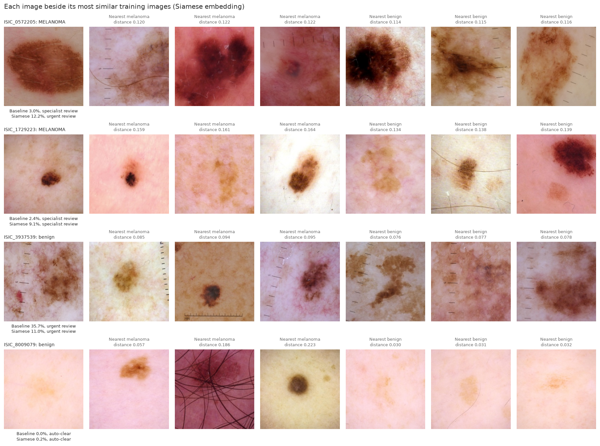
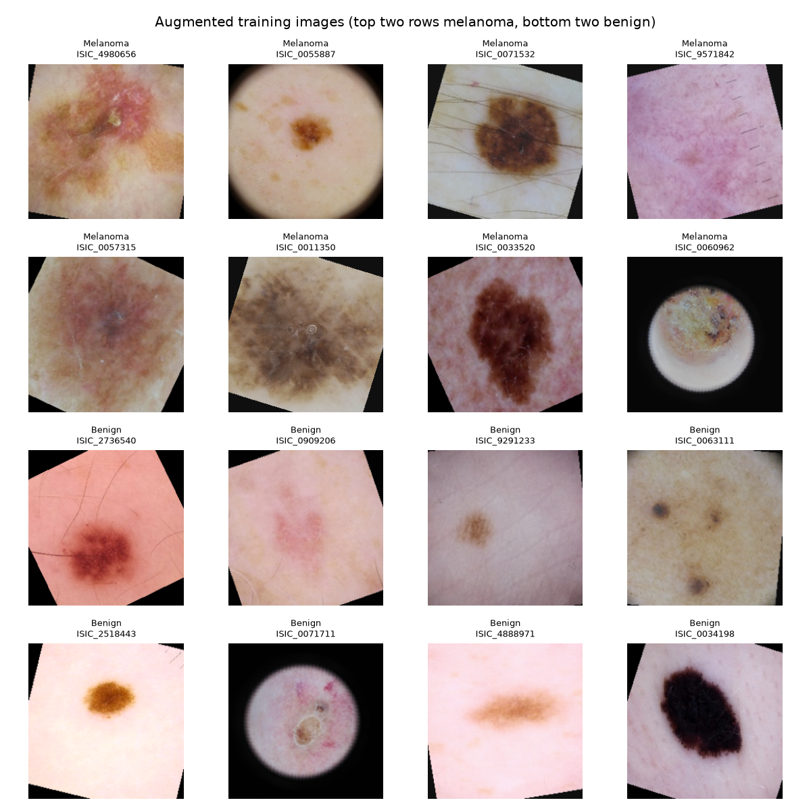
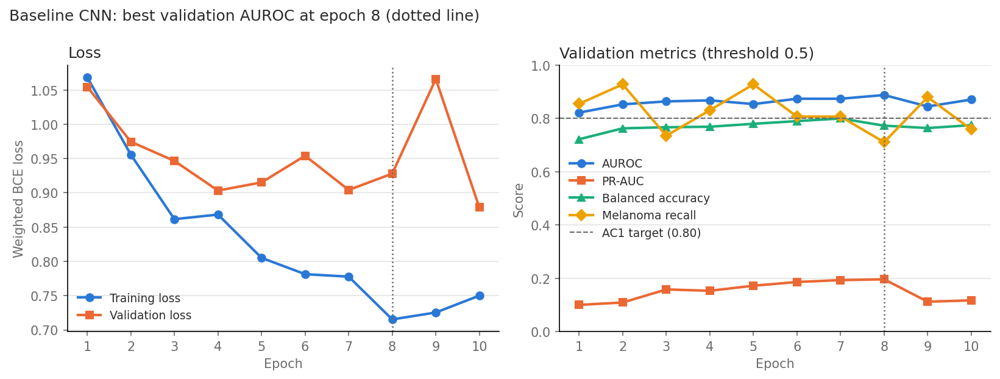
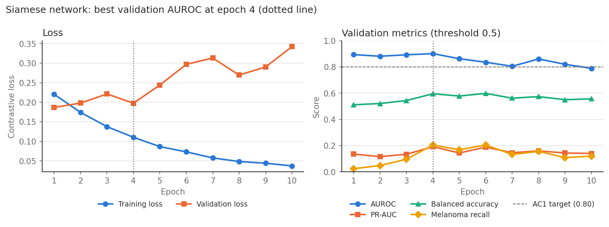
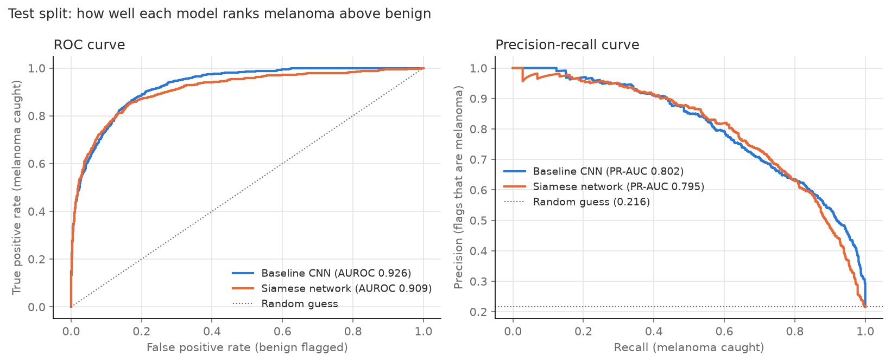
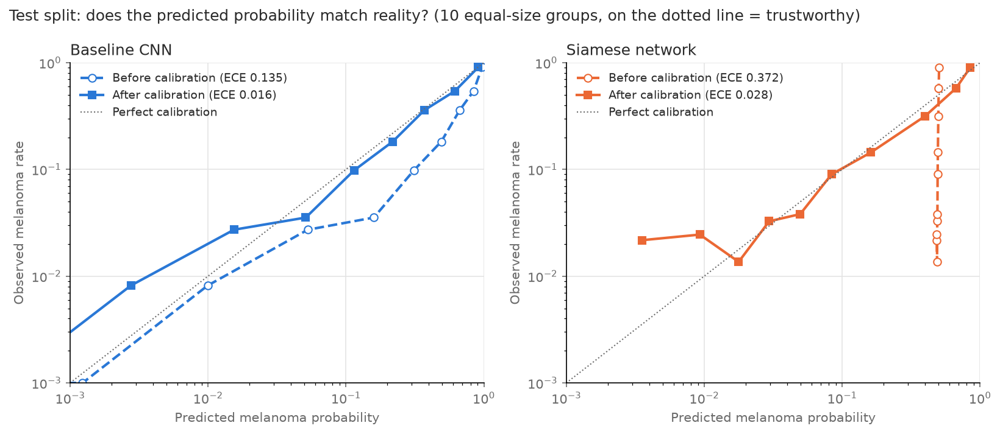
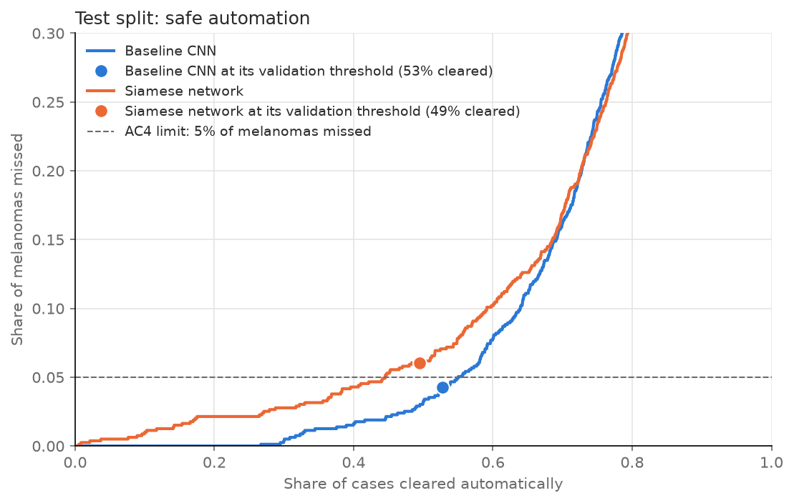
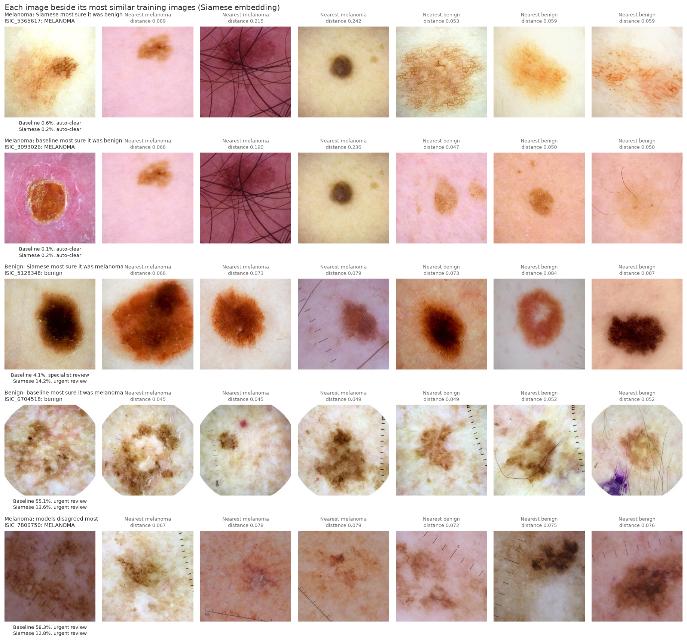

# Siamese Network for Melanoma Classification (ISIC)

## Feasibility Review

### 1. User Need, Scope and Acceptance Criteria

**User need**

The intended user is a skin-cancer screening clinic, where staff photograph each patient's lesions with a dermatoscope and a specialist reviews the images. Patients bring many lesions (a median of 12 per patient in ISIC 2020 [3]), so specialists cannot review every image promptly. Review delays matter: melanoma can spread to other parts of the body if it is not found early [1], and five-year relative survival falls from 100% when it is localised to 34% once it has spread to distant organs [2].

The clinic needs a triage assistant that:

1. **Separates melanoma from benign lesions reliably**, so suspicious lesions reach a specialist sooner and clearly benign ones do not use up review time (tested by AC1).
2. **Rarely misses a melanoma.** A missed melanoma can be fatal, while a false alarm costs only one extra specialist review, so the tool must favour catching melanoma over avoiding false alarms (AC4).
3. **Knows when it is unsure.** Melanoma is a minority of images (21.5% in the dataset used here, and under 2% in ISIC 2020 screening images [3]), and many benign lesions look like melanoma, so some cases will be genuinely hard. Deep networks are often confidently wrong [4], so the clinic needs a confidence score it can trust. Uncertain cases must go to a specialist instead of being decided automatically, an approach known as selective prediction or a reject option [5] (AC4).
4. **Holds up on new patients.** The tool will only ever see patients it was not trained on, so its reported performance must come from patients it has never seen (AC2).
5. **Fits into the existing workflow**, running on modest hardware and returning a result quickly enough not to slow down review (AC5).

**Scope**

In scope:
- Binary classification of a single dermoscopic image as melanoma or benign, using the ISIC melanoma images resized to 224x224 that the task sheet links [6] (24,493 images, 5,266 melanomas). They combine ISIC 2020 [3] with earlier ISIC collections, including HAM10000 [13].
- A confidence score for every prediction, and a rule that routes low-confidence cases to human review [5].
- A Siamese network [7] compared against a baseline CNN classifier on identical data splits.
- Training and evaluation on a GPU node of UQ's Rangpur HPC cluster, with development and small test runs on a MacBook (M5 Pro, 48 GB).

Out of scope:
- Locating lesions within wider skin photos (images are assumed to be pre-cropped).
- Using patient metadata such as age, sex or body site, although the dataset provides it [3].
- Comparing lesions within the same patient (the "ugly duckling" approach the dataset was designed to support [3]).
- Making a final diagnosis. The tool only supports a specialist's decision.

**Research question**

> Does a Siamese network, which classifies a lesion by comparing its learned embedding to labelled melanoma and benign reference images, produce confidence scores that better separate its correct predictions from its incorrect ones than a standard CNN classifier with the same pretrained backbone, and does this let it safely decide more cases automatically?

**Acceptance criteria**

#### AC1. Classification performance
- **Target:** Balanced accuracy of at least 0.80 on the held-out test split.
- **Why:** Only 21.5% of images are melanoma, so a model that always predicts benign scores about 78.5% plain accuracy. Balanced accuracy averages the recall of both classes, so it cannot be gamed this way.
- **How it is tested:** The decision threshold is chosen on the validation split only, then applied once to the test split.

#### AC2. Data hygiene and leakage prevention
- **Target:** Zero patient IDs shared between the train, validation and test splits, and zero duplicate images.
- **Why:** If one patient appears in both training and testing, the model can recognise the person's skin rather than the lesion, inflating test scores. Public copies of ISIC 2020 are known to contain duplicate images, so the same photo could otherwise appear in both training and testing.
- **How it is tested:** The splitting code asserts that the patient ID sets of the three splits do not overlap, and every image's pixels are hashed to check for duplicates before splitting.

#### AC3. Baseline comparison
- **Target:** The Siamese network and the baseline CNN classifier are evaluated on the identical test split under the controlled conditions above.
- **Why:** A complex model only earns its extra cost if it beats a simple one under the same conditions.
- **How it is tested:** Both models report per-class precision and recall, macro-F1, AUROC and PR-AUC in one comparison table.

#### AC4. Uncertainty and safe routing to specialists
- **Target:** A confidence threshold under which the cases decided automatically miss no more than 5% of melanomas. The percentage of cases routed to human review at that threshold is reported for both models.
- **Why:** This answers the research question directly. A useful model must be less confident when it is wrong, so that its mistakes land in the human review pile rather than being decided automatically [5].
- **How it is tested:** The threshold is set on the validation split and checked on the test split. Calibration is shown with a reliability diagram and ECE for both models [4].

#### AC5. Resource limits
- **Target:** Peak GPU memory under 16 GB during training on Rangpur, and single-image prediction under 100 ms.
- **Why:** A clinic tool must run on modest hardware and respond quickly enough to fit into a review workflow. A 16 GB limit means the model would also fit on a common mid-range GPU.
- **How it is tested:** Peak GPU memory is recorded during training, and prediction time is averaged over at least 50 test images after a warm-up run, on the same Rangpur GPU for both models. Parameter counts are reported for both models.

### 2. Model Choice and Course Concepts

**Chosen project and difficulty**

Siamese network for melanoma versus benign classification on the ISIC melanoma data linked in the task sheet, listed as **Hard** difficulty in the course specification. A baseline CNN classifier is built alongside it so the two can be compared under identical conditions.

**Dataset configuration**

| Setting | Choice | Reason |
|---|---|---|
| Source | ISIC melanoma images resized to 224x224 [6], combining ISIC 2020 [3] and earlier ISIC collections [13], copied to Rangpur | The dataset linked in the task sheet. All images are labelled, so train, validation and test splits are made from it. The resized copy keeps lesion detail while keeping storage and loading time manageable |
| Cleaning | Check for duplicate images by hashing their pixels | Stops identical images appearing in both training and testing |
| Split | 70% train, 15% validation, 15% test, split by patient | Every image from a patient stays in one split, so the model is tested on people it has never seen |
| Stratification | Patient IDs with at least one melanoma (5,079) and without (9,867) are split separately | Each split gets a similar share of melanoma |
| Input | 224x224 images with ImageNet colour normalisation, and random zoomed crops for training | Matches the input the pretrained encoder was trained on [9], [11] |
| Augmentation | Random flips, rotations and mild colour changes on training images only | Dermoscopic images have no fixed "up" direction, and colour varies between clinics and cameras [3] |

**Model architecture**

*Baseline CNN classifier.* An ImageNet-pretrained ResNet-18 [9] with its final layer replaced by a single output that gives the probability of melanoma. It is trained with binary cross-entropy, with melanoma cases weighted more heavily to offset the 21.5% class share. This is the standard way to approach the problem, so it is the fair point of comparison.

*Siamese network.* Two copies of the same ResNet-18 encoder with shared weights [7]. Each image is mapped to a 128-number embedding, scaled to unit length. Training uses pairs of images and contrastive loss [8]: pairs from the same class are pulled together and pairs from different classes are pushed at least a set distance apart.

- **Pair generation strategy.** The anchor image is drawn as melanoma half the time and benign half the time, and its partner is the same class half the time. This gives equal numbers of the four pair types (melanoma-melanoma, melanoma-benign, benign-benign, benign-melanoma), so melanoma is seen far more often than its natural 21.5% share. New pairs are drawn every epoch, so the training melanomas form many different pairs and the model is less likely to memorise them.
- **Making a prediction.** A new image is embedded and compared to a bank of labelled training images. For each class, the average distance to its 10 nearest reference images is computed. Taking the nearest neighbours of each class separately stops the large benign majority from outvoting melanoma. The two distances are turned into a melanoma probability, with a scaling factor tuned on the validation split so the confidence is well calibrated [4].
- **Why this suits the problem.** Classifying by comparison to confirmed cases mirrors how image retrieval has been used to support dermoscopic diagnosis [10]. It also gives an interpretable signal: a lesion that sits close to both melanoma and benign references is visibly ambiguous, and the nearest reference images can be shown to a specialist as evidence.

*Why both use ResNet-18.* Using the same pretrained encoder in both models means any difference in results comes from the Siamese training and comparison method, not from a stronger backbone. ResNet-18 is also small enough to train quickly on a Rangpur GPU and to test on a laptop during development.

**Course concepts applied**

| Concept | Where it is used |
|---|---|
| Convolutional neural networks and residual connections | ResNet-18 encoder in both models [9] |
| Transfer learning | Starting from ImageNet-pretrained weights [11] rather than random weights, since about 5,000 melanomas are too few to train a deep network from scratch |
| Metric learning | Siamese network with shared weights and contrastive loss [7], [8]. Triplet loss [12] was considered and is a possible later experiment |
| Data augmentation | Flips, rotations, zoomed crops and colour changes to reduce overfitting on the smaller melanoma class |
| Class imbalance | Weighted loss for the baseline, balanced pair sampling for the Siamese network, and evaluation with balanced accuracy and PR-AUC |
| Evaluation and model selection | Threshold and calibration chosen on the validation split only, with the test split used once at the end |
| Calibration and uncertainty | ECE, reliability diagrams and a reject option for routing cases to specialists [4], [5] |
| High-performance computing | Training runs submitted as batch jobs on the Rangpur GPU cluster, with short interactive sessions for debugging |

### 3. Preliminary Evidence

#### 3.1 Data Audit

Run with pandas on the downloaded dataset:

| Check | Result | What it means |
|---|---|---|
| Images | 24,493, all 224x224 | Ready for the pretrained encoder without resizing |
| Melanoma images | 5,266 (21.5%) | Need balanced metrics and balanced training |
| Patient IDs | 4,432 real IDs, up to 43 images each, plus 10,794 images with no patient ID | Must split by patient where possible to avoid leakage |
| Patient IDs with a melanoma | 5,079 (counting each image without an ID on its own) | Enough to spread across all three splits |
| Image sources | ISIC 2020 (5.2% melanoma), HAM10000 (24.4%) and other ISIC images (37.7%) | Melanoma share differs strongly by source |
| Duplicate images | None, checked by hashing every image's pixels | No removal needed |

#### 3.2 Training Time and Resource Estimate

Measured: the first 3 epochs of a baseline run on the full training split (17,049 images, batch size 64) took about 1.5 minutes each (89 to 105 seconds) on the MacBook (M5 Pro, Apple GPU). The average training loss fell each epoch, from 0.69 to 0.60 to 0.57, confirming the data pipeline and training loop work end to end.

Estimated: ResNet-18 has about 11 million parameters. At batch size 64, the baseline should need roughly 3 to 5 GB of GPU memory and the Siamese network about 5 to 7 GB, since it processes two images per pair. Both fit the 16 GB limit. Memory had not been measured at this stage (see Resource profiling in the Results section for the measured values).

### 4. Risks, Budget and Fallback

#### 4.1 Risks

| Risk | Plan |
|---|---|
| 10,794 images have no patient ID | Split them one image at a time, and report possible leakage as a limitation |
| Melanoma share differs strongly between image sources | Check failure cases for source effects and report it as a limitation |
| Confident wrong predictions | Tune confidence on validation data and check reliability diagrams |
| Test results may vary with the sample of patients | Report confidence intervals by resampling the test set |
| Training time on a laptop | Quick tests on a small random subset (`--limit`) before full runs, and keep the best epoch so runs are not repeated |

#### 4.2 Budget

About 15 minutes per 10-epoch run at the measured 1.5 minutes per epoch. Around 15 runs across both models comes to roughly 4 hours of training on the MacBook.

#### 4.3 Next Experiment

Add validation metrics (balanced accuracy, AUROC, PR-AUC and melanoma recall) to the training loop, then run 10 epochs of the baseline and keep the epoch with the best validation AUROC.

#### 4.4 Fallback

If the Siamese network stays below 0.80 balanced accuracy, first try triplet loss [12] or harder pairs (images that look alike but have different labels). If it still falls short, report the baseline as the working model and present the Siamese results as an honest negative finding.


## Changes from the Feasibility Review

**Compute.** The feasibility review planned to train on UQ's Rangpur cluster, with a MacBook used for development and small tests. After testing, all training and evaluation were done on the MacBook (M5 Pro, 48 GB, Apple GPU) instead. A baseline epoch over 17,049 training images took about 1.5 minutes, so a 10-epoch run finishes in about 15 minutes. Peak training memory was 2.46 GB for the baseline and 4.61 GB for the Siamese network. That was fast enough to iterate without cluster queue times or copying the dataset to Rangpur. The memory target was also lowered from 16 GB to 8 GB, so the models would fit on an entry-level GPU.

**Calibration.** The feasibility review planned to turn the Siamese distances into a probability with a single scaling factor. The final version uses Platt scaling for both models instead. It fits two numbers (a scale and an offset) on the validation split, so the baseline and Siamese probabilities are calibrated in the same way and can be compared fairly [4].

**Routing.** The feasibility review described a single threshold between automatic decisions and human review. The final version uses three groups: auto-clear, specialist review and urgent review, so that the most suspicious lesions are seen first. Urgent review uses each model's balanced threshold, chosen on the validation split, so urgent means the model predicts melanoma, and the images between the auto-clear and balanced thresholds are the uncertain cases sent to specialist review.

**Effect on results.** Apple and NVIDIA GPUs do floating-point maths slightly differently, so rerunning on Rangpur with the same seed may give slightly different numbers. Both models were trained and tested on the same MacBook, so the comparison between them is unaffected.

## Overview

**The problem.** Melanoma is the most dangerous common skin cancer, and it is far more treatable when it is found early [1], [2]. Skin-cancer clinics photograph many lesions per patient with a dermatoscope, and a specialist has to review every image. Most of these lesions are harmless, so much of the specialist's time goes on images that did not need review. This project builds a triage tool for that workflow. For each dermoscopic image it estimates the chance of melanoma and sends the image to one of three groups: auto-clear, specialist review or urgent review. It uses the ISIC melanoma images resized to 224x224 that the task sheet links [6], which combine ISIC 2020 [3] with earlier ISIC collections. In this copy, 21.5% of images are melanoma.

**How it works.** The main model is a Siamese network [7]. A ResNet-18 encoder [9], pretrained on ImageNet [11], turns each image into 128 numbers called an embedding. The network is trained on pairs of images with contrastive loss [8], which pulls images of the same class together and pushes images of different classes apart. To predict a new image, the network finds the 10 most similar melanomas and the 10 most similar benign lesions among the training images, and compares the average distance to each group. A lesion that sits closer to the melanomas is more likely to be melanoma. This distance gap is turned into a probability using Platt scaling fitted on the validation split [4], and the probability decides which group the image goes to. A standard ResNet-18 classifier with the same pretrained encoder is trained as the baseline, and both models are compared on the same unseen patients.



*Four random test images from `predict.py`. Each row shows the test image, both models' predictions and routing decisions, and the three most similar training melanomas and benign lesions found by the Siamese network. A smaller distance means a closer match.*

**Main findings.** On the test split, the baseline ranks lesions slightly but significantly better than the Siamese network (AUROC 0.926 against 0.909, with a 95% interval for the difference that excludes zero). Both reach the task sheet's target of about 0.8 test accuracy (0.828 and 0.839) and the 0.80 balanced accuracy target. The baseline's confidence is better at telling its right answers from its wrong ones (0.826 against 0.756), which goes against the research hypothesis. The baseline also met the 5% missed-melanoma target for auto-cleared images on the test split (4.3%), while the Siamese network did not (6.1%). The full results are in the [Results](#results) section.

## Setup and Usage

### Requirements

- Python 3.14 (tested with 3.14.5)
- The packages in `requirements.txt`, with exact versions:

| Package | Version |
|---|---|
| torch | 2.14.1 |
| torchvision | 0.29.1 |
| numpy | 2.5.4 |
| pandas | 3.0.6 |
| scikit-learn | 1.9.1 |
| matplotlib | 3.11.2 |
| pillow | 12.3.0 |

The code runs on an Apple GPU (MPS) when one is available and falls back to the CPU otherwise. All results in this README were produced on a MacBook Pro (M5 Pro, 48 GB). Training on the CPU works but is much slower.

### Installation

```bash
git clone https://github.com/dhruvanil55/PatternAnalysis-2026.git
cd PatternAnalysis-2026
git checkout topic-recognition
cd recognition/Siamese_ISIC2020_s4808626
python3 -m venv .venv
source .venv/bin/activate
pip install -r requirements.txt
```

### Dataset

Download "ISIC Melanoma Dataset Resized to 224x224" from Kaggle [6], the dataset linked in the course task sheet. Unzip it and rename the folder so it looks like this:

```
~/isic224/
    cleaned_metadata.csv
    combined_images/
        ISIC_0000000.jpg
        ...
```

`cleaned_metadata.csv` has three columns: `isic_id`, `patient_id` and `target` (1 for melanoma, 0 otherwise). The dataset and trained models are not committed to this repository.

### Running the pipeline

Run these commands in order from this folder. Each step saves the files the next step needs.

| Step | Command | What it does | Time on the MacBook |
|---|---|---|---|
| 1 | `python dataset.py --data-dir ~/isic224 --preview` | Loads the metadata, splits patients into train, validation and test, checks for leakage, and saves the splits to `splits/` | under a minute |
| 2 | `python train.py --data-dir ~/isic224 --model baseline` | Trains the baseline CNN for 10 epochs and saves the best epoch to `outputs/baseline_best.pt` | about 15 minutes |
| 3 | `python train.py --data-dir ~/isic224 --model siamese` | Trains the Siamese network for 10 epochs and saves the best epoch to `outputs/siamese_best.pt` | about 17 minutes |
| 4 | `python train.py --data-dir ~/isic224 --test` | Tests both saved models. It fits calibration and thresholds on validation, scores the test split once, and saves the results and test figures | a few minutes |
| 5 | `python predict.py --data-dir ~/isic224` | Prints predictions for four random test images and saves `figures/example_predictions.png` | seconds |

Step 4 runs the testing code in `evaluate.py`, so `python evaluate.py --data-dir ~/isic224` gives exactly the same results. Steps 3 and 4 can also be combined as `python train.py --data-dir ~/isic224 --model siamese --test`, which trains the Siamese network and then tests both models.

Useful options:

- `--limit 512` on `train.py` (including with `--test`) or `evaluate.py` runs on a small random subset to check that everything works. These quick runs save their files with a `quicktest` name, so they never overwrite a full run.
- `python predict.py --data-dir ~/isic224 --failures` picks the most informative mistakes on the test split and saves `figures/failure_cases.png`.
- `python predict.py --data-dir ~/isic224 --images ISIC_0067816 ISIC_0034937` predicts specific images.
- `python dataset.py --data-dir ~/isic224 --check-pairs` checks that the Siamese training pairs are balanced.

### Example output

Running `python predict.py --data-dir ~/isic224` prints:

```
Image         Truth       Baseline  decision            Siamese  decision           nearest mel nearest ben
ISIC_0067816  melanoma       90.7%  urgent review         72.8%  urgent review            0.146       0.158
ISIC_0032441  melanoma       75.2%  urgent review         77.2%  urgent review            0.141       0.135
ISIC_0071241  benign         36.0%  urgent review         34.1%  urgent review            0.133       0.119
ISIC_0034937  benign          4.7%  auto-clear             5.9%  auto-clear               0.173       0.139

Saved figure to figures/example_predictions.png
```

The percentages are each model's calibrated chance of melanoma. The last two columns are the distances to the closest training melanoma and the closest benign training lesion in the Siamese network's embedding.

### Files

| File | Contents |
|---|---|
| `dataset.py` | Loading the metadata, patient-level splitting, image transforms, and the single-image and pair datasets |
| `modules.py` | The ResNet-18 backbone, the baseline classifier, the Siamese network, contrastive loss, and the nearest-neighbour distance calculation |
| `train.py` | Training and validation loops for both models, saving the best epoch, plotting the training curves, and the `--test` option that tests both saved models |
| `evaluate.py` | Helper with the testing code used by `train.py --test`: calibration, thresholds, test metrics, confidence intervals, resource profiling and the test figures. It is a separate file because testing needs both trained models at once |
| `predict.py` | Example predictions and failure cases, printed and shown as figures |
| `utils.py` | Shared helpers for the device, random seeds, data loader settings and plot styling |

### Reproducibility

- **Fixed splits.** Patients are assigned to splits with a fixed seed (42), and the splits are saved as CSV files in `splits/`. Every later step reads these files, so both models always use exactly the same patients.
- **Fixed training randomness.** `train.py` fixes the Python and PyTorch random seeds (42), which controls the order of the training images, the augmentations, the Siamese training pairs and the starting weights of the new final layers. The validation pair loss always uses the same 2,000 pairs, and the bootstrap confidence intervals in `evaluate.py` use a fixed seed.
- **Checked by rerunning.** During development, the baseline was trained twice from scratch on the same MacBook with the same seed, and every epoch gave identical losses and validation scores.
- **Different hardware.** Apple, NVIDIA and CPU calculations add numbers in slightly different orders, so running on other hardware or other package versions may give slightly different numbers. The exact package versions are pinned in `requirements.txt` to limit this.
- **Choosing the saved model.** Both models always train for the full 10 epochs. After each epoch the model is scored on the validation split, and it is saved only when the validation AUROC is the best so far. This keeps the best epoch, but it is not early stopping, because training does not end early.
- **Test split used once.** Calibration, the balanced threshold and the routing thresholds are all chosen on the validation split. The test split is only scored once, by `evaluate.py`.

## Pre-processing and Data Splits

### Dataset contents

The dataset combines images from several ISIC collections. The source of each image can be told from its patient ID, and the melanoma rate is very different between sources:

| Source | How it is identified | Images | Melanomas | Melanoma share |
|---|---|---|---|---|
| ISIC 2020 [3] | Real patient IDs (`IP_...`) | 11,186 | 581 | 5.2% |
| HAM10000 [13] | Lesion IDs (`HAM_...`) | 2,513 | 614 | 24.4% |
| Other earlier ISIC images | No patient ID (placeholder `dummy_...`) | 10,794 | 4,071 | 37.7% |
| **Total** | | **24,493** | **5,266** | **21.5%** |

The task sheet describes melanoma as less than 2% of screening images, which matches ISIC 2020 alone. This copy has a much higher melanoma share because the earlier ISIC collections contain many more melanomas.

### Duplicate check

Public copies of ISIC 2020 contain duplicate images, so this dataset was checked before use. Every image's decoded pixels were hashed with a one-off script, and no two images were identical. No images were removed, so `dataset.py` does not include a duplicate removal step.

### Patient-level split

Images from the same patient often share skin tone, lighting and camera. If one patient's images were spread across splits, the model could learn to recognise the patient rather than the lesion. To prevent this, every patient ID is assigned to exactly one split, and `dataset.py` checks that no ID appears in more than one.

Patient information is incomplete in this dataset:

- **ISIC 2020 images** have real patient IDs, with up to 43 images per patient, so these are fully protected.
- **HAM10000 images** have one image per lesion ID here.
- **The other 10,794 images** have no patient ID. Each has a placeholder ID, and 280 placeholders cover two images each. These images are split one at a time, so two photos of the same patient could end up in different splits. This is a limitation of the data, discussed in [Limitations](#limitations).

Patient IDs are split in two groups: the 5,079 IDs with at least one melanoma, and the 9,867 without. Each group is shuffled with a fixed seed (42) and divided 70/15/15, so every split gets a similar share of melanoma.

| Split | Images | Patient IDs | Melanomas | Melanoma share |
|---|---|---|---|---|
| Train | 17,049 | 10,462 | 3,662 | 21.5% |
| Validation | 3,773 | 2,242 | 811 | 21.5% |
| Test | 3,671 | 2,242 | 793 | 21.6% |

### Why 70/15/15

- **Training (70%)** gets most of the data, so the models see as many kinds of melanoma as possible.
- **Validation (15%)** is used to choose the best training epoch, fit the calibration, and set the routing thresholds. Its 811 melanomas make these choices reasonably stable, and it is separate from the test split so the test result stays honest.
- **Test (15%)** is used only once, at the end. With 793 melanomas, one missed melanoma changes the miss rate by about 0.13 percentage points, so the results are reasonably stable. Confidence intervals are still reported.

### Image pre-processing

The images are already resized to 224x224 [6], the input size ResNet-18 was pretrained on [9].

| Step | Training images | Validation and test images | Reason |
|---|---|---|---|
| Flips | Random horizontal and vertical flips | None | Dermoscopic images have no fixed "up" direction |
| Rotation | Random rotation of up to 30 degrees | None | Same reason as flips |
| Crop | Random square crop covering 80 to 100% of the image, resized back to 224x224 | None, the full image is used | Adds variety in lesion size and position. The images are already 224x224, so a plain 224x224 crop would change nothing |
| Colour | Small random changes to brightness, contrast and saturation (up to 20%) and hue (up to 2%) | None | Colour varies between clinics and cameras [3] |
| Normalisation | ImageNet mean and standard deviation | Same | Matches the colour statistics the pretrained encoder expects [11] |

Augmentation is only applied to training images, so validation and test results are the same every time they are run.



*Sample training images after augmentation, saved by `python dataset.py --data-dir ~/isic224 --preview`.*

### Handling class imbalance

21.5% of training images are melanoma, so without any correction a model would lean towards predicting benign.

- **Baseline CNN.** The loss gives each melanoma image 3.66 times the weight of a benign image, which is the ratio of benign to melanoma images in the training split. With this weight, the melanoma class carries the same total weight in the loss as the benign class.
- **Siamese network.** Training pairs are drawn with two coin flips. The first image is melanoma or benign with equal chance, and the second image is from the same class or the other class with equal chance. This gives the four pair types (melanoma-melanoma, melanoma-benign, benign-benign and benign-melanoma) in equal numbers, so half of all images the network sees in training are melanomas. New pairs are drawn every epoch, with 8,524 pairs per epoch (half the number of training images).

## Method Details

### Baseline CNN

The ResNet-18 backbone turns an image $x$ into 512 features, and a linear layer turns these into one score $z$. The model is trained with weighted binary cross-entropy, where $y = 1$ for melanoma and $\sigma$ is the sigmoid function:

$$
\mathcal{L}_{\text{BCE}} = -\Big[\, w \, y \log \sigma(z) + (1 - y) \log\big(1 - \sigma(z)\big) \Big], \qquad w = \frac{N_{\text{benign}}}{N_{\text{melanoma}}} = 3.66
$$

### Siamese network

Both images in a pair go through the same encoder: the ResNet-18 backbone followed by a linear layer with 128 outputs, scaled to unit length. For a pair with embeddings $e_a$ and $e_b$, the distance is $d = \lVert e_a - e_b \rVert_2$, which lies between 0 and 2. The contrastive loss [8], with $s = 1$ for a same-class pair and $s = 0$ otherwise, is

$$
\mathcal{L}_{\text{contrastive}} = s \, d^2 + (1 - s) \max(0, \, m - d)^2, \qquad m = 1.0
$$

Same-class pairs are pulled together, and different-class pairs are pushed apart until they are at least $m$ apart.

To score a new image, its embedding is compared with the embeddings of all 17,049 training images. $D_{\text{mel}}(x)$ is the average distance to its $k = 10$ nearest training melanomas, and $D_{\text{ben}}(x)$ is the average distance to its 10 nearest benign training images. The score is the gap between them:

$$
s(x) = D_{\text{ben}}(x) - D_{\text{mel}}(x)
$$

A positive score means the image is closer to the melanomas than to the benign lesions.

### Calibration

Each model's score ($z$ for the baseline, $s(x)$ for the Siamese network) is turned into a calibrated probability with Platt scaling [4]:

$$
\hat{p} = \sigma(a \cdot \text{score} + b)
$$

$a$ and $b$ are fitted by logistic regression on the validation split only, and then applied unchanged to the test split. The fitted values were $a = 1.009, \, b = -1.252$ for the baseline and $a = 86.44, \, b = 0.145$ for the Siamese network. The baseline's offset is close to $-\ln(3.66) = -1.30$, so calibration mostly undoes the melanoma loss weight. The Siamese network needs a very large scale because its distance gaps are small numbers.

### Thresholds

All three thresholds are chosen on the validation split:

- **Balanced threshold** $t_{\text{bal}}$: the probability that maximises melanoma recall plus benign recall (Youden's index on the ROC curve). Used for the classification metrics.
- **Auto-clear threshold** $t_{\text{clear}}$: the highest probability below which at most 5% of validation melanomas fall. With 811 validation melanomas, this allows 40 to be cleared, so the threshold is the 41st lowest melanoma probability.
- **Urgent threshold**: the balanced threshold $t_{\text{bal}}$, or $t_{\text{clear}}$ if that is higher. Urgent review therefore means the model predicts melanoma, and images between $t_{\text{clear}}$ and $t_{\text{bal}}$ are the uncertain cases sent to specialist review.

### Settings

| Setting | Value |
|---|---|
| Backbone | ResNet-18 with torchvision's ImageNet weights (IMAGENET1K_V1) [9], [11] |
| Input | 224x224 images (training images get a random crop of 80 to 100%, resized back to 224x224) |
| Embedding size | 128, scaled to unit length |
| Contrastive margin $m$ | 1.0 |
| Nearest references per class $k$ | 10 |
| Melanoma loss weight $w$ (baseline) | 3.66 |
| Optimiser | AdamW, learning rate 0.0001, weight decay 0.01 (the PyTorch default) |
| Learning rate schedule | None, the learning rate stays constant |
| Batch size | 64 images (baseline) or 64 pairs (Siamese network) |
| Epochs | 10, keeping the epoch with the best validation AUROC |
| Training pairs per epoch | 8,524 (half the number of training images) |
| Validation pair loss | The same 2,000 validation pairs every epoch |
| Platt scaling | Logistic regression on validation, with almost no regularisation ($C = 10^6$) |
| Auto-clear rule | At most 5% of validation melanomas cleared |
| Urgent review | At or above the balanced threshold |
| Confidence intervals | 1,000 bootstrap resamples of test patients |
| Random seed | 42 |

The margin, $k$ and learning rate were set before training and were not tuned. Each model was trained once with one seed.

## Results

All numbers below come from `evaluate.py`. Both models were scored on the same held-out test split of 3,671 images from 2,242 patient IDs, of which 793 (21.6%) are melanomas. Calibration and every threshold were chosen on the validation split only, and the test split was scored once.

### Training




Both models were trained for 10 epochs with AdamW (learning rate 0.0001, batch size 64). After each epoch the model was scored on the validation split, and the epoch with the highest validation AUROC was saved. The dotted line in each figure marks that epoch.

- **Baseline CNN.** The best epoch was epoch 4, with a validation AUROC of 0.930. After that, the training loss kept falling (0.540 to 0.414) while the validation loss moved up and down between 0.55 and 0.64 and the validation AUROC stayed between 0.919 and 0.929. This is mild overfitting, and saving the best epoch protects against it.
- **Siamese network.** The best epoch was epoch 5, with a validation AUROC of 0.919. Both the training pair loss (0.226 to 0.158) and the validation pair loss (0.194 to 0.169 by epoch 9) kept falling, but the validation AUROC did not improve after epoch 5 and dropped to 0.895 by epoch 10. Pulling pairs closer together did not keep improving how well the embedding separates melanoma from benign.

During training, the Siamese network's validation melanoma recall stayed between 0.62 and 0.73. Training uses a fixed cut-off where the distance gap is zero, and before calibration the scores lean towards benign, because a new image usually has more benign images than melanomas close to it. Platt scaling in `evaluate.py` corrects this.

### Test performance (AC1 and AC3)

Metrics in the table use each model's balanced threshold, the cut-off that best balances melanoma and benign recall on the validation split (24.0% for the baseline and 22.1% for the Siamese network). Values in brackets are 95% confidence intervals from 1,000 bootstrap resamples of test patients.

| Metric | Baseline CNN | Siamese network |
|---|---|---|
| AUROC | 0.926 [0.914, 0.937] | 0.909 [0.894, 0.923] |
| PR-AUC | 0.802 | 0.795 |
| Accuracy | 0.828 | 0.839 |
| Balanced accuracy | 0.846 [0.830, 0.860] | 0.842 [0.825, 0.856] |
| Melanoma recall | 0.876 (695 of 793) | 0.846 (671 of 793) |
| Melanoma precision | 0.566 | 0.589 |
| Benign recall | 0.815 | 0.837 |
| Benign precision | 0.960 | 0.952 |
| Macro-F1 | 0.785 | 0.792 |
| Benign lesions flagged as melanoma | 532 | 469 |
| Melanomas missed | 98 | 122 |



- **The baseline ranks lesions better.** Its AUROC is 0.017 higher, and the 95% interval for the Siamese minus baseline difference is [-0.025, -0.008]. The interval excludes zero, so the difference is statistically significant, although small.
- **Both meet the classification targets.** Balanced accuracy is 0.846 and 0.842, above the 0.80 target in AC1, and the intervals overlap, so neither model is clearly better on this measure.
- **They make different trade-offs.** The baseline catches 24 more melanomas (695 against 671) but raises 63 more false alarms (532 against 469). In a screening tool, a missed melanoma costs far more than an extra review.
- **Both reach the task sheet's accuracy target.** Plain accuracy is 0.828 for the baseline and 0.839 for the Siamese network, around the target of 0.8. It is still not the main metric, because 78.4% of test images are benign, so a model that called every image benign would score 0.784 while missing every melanoma.
- **PR-AUC is high for both.** PR-AUC measures how often the most suspicious images are real melanomas. Random guessing would score about 0.22 here (the melanoma share), so 0.802 and 0.795 are far above chance.

### Calibration and confidence (research question)



| Measure | Baseline CNN | Siamese network |
|---|---|---|
| ECE before calibration | 0.135 | 0.372 |
| ECE after calibration | 0.016 | 0.028 |
| AUROC of confidence for correctness | 0.826 | 0.756 |

The two measures in this table answer different questions.

**Expected calibration error (ECE)** asks whether the probabilities can be taken at face value: of the images given about 10%, are about 10% really melanoma? The test probabilities are split into 10 equal-width bins (0 to 10%, 10 to 20%, and so on), and ECE is the average gap between the mean predicted probability and the actual melanoma rate in each bin, weighted by the number of images in the bin.

**AUROC of confidence for correctness** asks whether a model knows when it is wrong. Each test image is first classified as melanoma or benign using the balanced threshold, and marked correct or incorrect. The model's confidence is how far its calibrated score is from that threshold, measured in log-odds: $c = \lvert \operatorname{logit}(\hat{p}) - \operatorname{logit}(t_{\text{bal}}) \rvert$. A prediction just above or below the threshold has low confidence, and one far from it has high confidence. The AUROC measures how often a correct prediction has higher confidence than an incorrect one, where 0.5 is no better than chance.

A model can score well on one and poorly on the other. Good calibration means the probabilities are right on average, but it does not mean the model gives its wrong answers lower confidence. Routing depends on the second property, because mistakes only reach a doctor if the model is unsure about them.

- **Calibration was essential for both models.** Before calibration, the Siamese network's raw scores were almost all close to 50% (the hollow circles in the right panel form a vertical line), so they carried almost no probability information. The baseline's raw probabilities were too high, because of the melanoma loss weight. After Platt scaling, both have a test ECE below 0.03.
- **Both models are overconfident at the lowest probabilities.** In the reliability diagram, the groups given the lowest probabilities (well under 1%) contain more melanomas than predicted, roughly 1% for the baseline and 2% for the Siamese network. This is exactly where the auto-clear threshold sits, so the probabilities of the safest-looking images should not be taken too literally. ECE hides this, because these groups contribute little to its average.
- **The baseline's confidence is more useful.** The baseline scores 0.826 and the Siamese network 0.756. This goes against the hypothesis in the research question: the Siamese network's distance-based confidence does not track its mistakes better than a standard classifier. No confidence interval was calculated for this gap.

### Routing to specialists (AC4)

Each test image is sent to one of three groups using its calibrated melanoma probability: auto-clear (below the auto-clear threshold), urgent review (at or above the balanced threshold, meaning the model predicts melanoma), or specialist review (everything in between). The auto-clear threshold was set on validation so that no more than 5% of validation melanomas would be cleared.

| Measure | Baseline CNN | Siamese network |
|---|---|---|
| Auto-clear threshold | 9.6% | 6.3% |
| Urgent threshold (balanced threshold) | 24.0% | 22.1% |
| Validation melanomas auto-cleared | 40 of 811 (4.9%) | 40 of 811 (4.9%) |
| Test images auto-cleared | 52.8% [49.5, 55.9] | 49.4% [46.4, 52.5] |
| Test images sent to specialist review | 13.8% | 19.5% |
| Test images sent to urgent review | 33.4% | 31.1% |
| Test melanomas auto-cleared | 34 of 793 (4.3%) [2.7, 6.1] | 48 of 793 (6.1%) [4.4, 7.8] |
| Share of urgent cases that were melanoma | 56.6% | 58.9% |



*Risk-coverage curve for routing. Each point is a possible auto-clear threshold, showing the share of test images that would be cleared (coverage) against the share of test melanomas that would be missed (risk). The dots mark each model's validation threshold.*

- **The baseline met the 5% target on test, the Siamese network did not.** Both models auto-cleared 4.9% of validation melanomas. On the test split the baseline cleared 4.3% and the Siamese network 6.1%. The baseline's 95% interval (2.7% to 6.1%) still includes values above 5%, so its result is encouraging but not a guarantee.
- **The baseline is safer at every level of automation.** Its curve stays below the Siamese curve almost everywhere. It clears about the first 27% of images without missing any melanoma, while the Siamese network misses some melanomas even among the images it is most sure are benign.
- **The baseline also automates slightly more.** It auto-cleared 52.8% of test images against 49.4%, although the intervals overlap.
- **The urgent group is focused.** More than half of urgent cases were melanoma (56.6% and 58.9%), against 21.6% across the whole test split, so specialists would see the most likely melanomas first.

### Resource profiling (AC5)

| Measure | Baseline CNN | Siamese network |
|---|---|---|
| Parameters | 11,177,025 | 11,242,176 |
| Peak GPU memory during training (batch of 64) | 2.46 GB | 4.61 GB |
| Prediction time per image | 3.5 ms | 3.6 ms |
| Training time per epoch | about 1.5 minutes | about 1.7 minutes |
| Extra storage needed at prediction time | none | 8.7 MB of reference embeddings |

All measurements were taken on a MacBook Pro (M5 Pro, 48 GB) using the Apple GPU. Peak memory is the memory the GPU driver held over five training steps. Prediction time is the average over 50 test images, one at a time, after 10 warm-up runs. For the Siamese network it includes comparing the new embedding with all 17,049 stored training embeddings.

- Both models have almost the same number of parameters, since they share the ResNet-18 backbone. The Siamese network only swaps the final layer for a 128-number embedding layer.
- The Siamese network uses about twice the training memory, because every training step processes two images per pair.
- Both models are far inside the AC5 limits of 8 GB of memory and 100 ms per image.

### Acceptance criteria summary

| Criterion | Target | Baseline CNN | Siamese network |
|---|---|---|---|
| AC1. Classification | Balanced accuracy of at least 0.80 on test | Met (0.846) | Met (0.842) |
| AC2. Data hygiene | No shared patients, no duplicates | Partly met. No patient ID is shared between splits and no duplicate images were found, but 10,794 images have no patient ID | Same |
| AC3. Baseline comparison | Both models on the same test split | Met | Met |
| AC4. Safe routing | At most 5% of melanomas auto-cleared | Met on validation (4.9%) and test (4.3%) | Met on validation (4.9%), not on test (6.1%) |
| AC5. Resources | Under 8 GB memory and 100 ms per image | Met (2.46 GB, 3.5 ms) | Met (4.61 GB, 3.6 ms) |

## Failure Analysis



*Five test images chosen by `python predict.py --data-dir ~/isic224 --failures`. Three are melanomas (rows 1, 2 and 5) and two are benign (rows 3 and 4).*

### How the cases were chosen

The `--failures` option searches the 3,671 test images for the most informative mistakes:

- Row 1: the melanoma the Siamese network was most confident was benign
- Row 2: the melanoma the baseline CNN was most confident was benign
- Row 3: the benign lesion the Siamese network was most confident was melanoma
- Row 4: the benign lesion the baseline CNN was most confident was melanoma
- Row 5: the melanoma where the two models gave the most different answers

### How to read the figure

Each row is one test image. The first column is the test image itself, with its true diagnosis above it and both models' predictions below it. The next three columns are the three training melanomas that the Siamese network considers most similar to it. The last three columns are the three most similar benign training lesions.

The number above each training image is its distance from the test image in the Siamese network's embedding. A smaller distance means the network sees the two images as more alike. In these examples, distances range from about 0.06 to 0.35.

The neighbours only show how the Siamese network sees an image. They cannot explain the baseline's prediction, because the baseline is a separate model.

### How the percentages were calculated

Each percentage is the model's estimated chance that the lesion is melanoma.

- **Baseline CNN.** The ResNet-18 classifier gives each image a single score. That score is converted into a probability using Platt scaling, a small correction fitted on the validation split so that, for example, images given 10% really are melanoma about 10% of the time.
- **Siamese network.** The network turns the test image into an embedding and finds its 10 nearest melanomas and 10 nearest benign lesions among the 17,049 training images. It works out the average distance to each group. If the image is closer on average to the melanomas, it is more likely to be melanoma. The difference between the two averages is then converted into a probability with Platt scaling, in the same way as the baseline. The figure only shows the closest three of each group, so it gives a good idea of the decision but not the full calculation.

### How each case was routed

Each probability is compared with thresholds chosen on the validation split:

| Decision | Baseline CNN | Siamese network |
|---|---|---|
| Auto-clear | below 9.6% | below 6.3% |
| Specialist review | 9.6% to under 24.0% | 6.3% to under 22.1% |
| Urgent review | 24.0% or above | 22.1% or above |

| Row | Image | Source | True diagnosis | Baseline | Siamese | Outcome |
|---|---|---|---|---|---|---|
| 1 | ISIC_0062816 | No patient ID | Melanoma | 13.7%, specialist review | 0.1%, auto-clear | Missed by the Siamese network only |
| 2 | ISIC_3065032 | ISIC 2020 | Melanoma | 0.3%, auto-clear | 6.9%, specialist review | Missed by the baseline only |
| 3 | ISIC_6878588 | ISIC 2020 | Benign | 84.6%, urgent review | 93.6%, urgent review | False alarm |
| 4 | ISIC_0059563 | No patient ID | Benign | 97.8%, urgent review | 79.0%, urgent review | False alarm |
| 5 | ISIC_0061131 | No patient ID | Melanoma | 69.9%, urgent review | 8.1%, specialist review | Caught by both, but the Siamese network was unsure |

### What each case shows

Each case below separates what the figure shows from the likely explanation, which is a hypothesis that has not been tested.

**Row 1 (melanoma, missed by the Siamese network).**
- *Observed:* the lesion is small, faint and light brown, in the middle of a round black dermoscope frame that fills most of the image. The Siamese network gave it 0.1% and auto-cleared it. The baseline gave 13.7%, enough for specialist review.
- *Evidence:* all six nearest training images, melanoma and benign, show the same round black frame with a small lesion in the centre. The nearest benign images (0.144 to 0.152) are about as close as the nearest melanoma (0.141), and closer than the next two melanomas (0.188 and 0.202).
- *Likely explanation:* the lesion takes up only a small part of the image, so the embedding seems to be matching the frame and overall appearance more than the lesion. Most similar-looking training images are benign, so the gap points to benign.
- *What to try:* crop each image to the lesion, or mask the dermoscope frame, before embedding.

**Row 2 (melanoma, missed by the baseline).**
- *Observed:* a faint, light brown lesion with hairs and ruler markings, from ISIC 2020. The baseline gave it 0.3% and auto-cleared it. The Siamese network gave 6.9%, just above its 6.3% auto-clear threshold, so it was sent for specialist review.
- *Evidence:* the nearest benign images (0.075 to 0.078) are closer than the nearest melanomas (0.094 to 0.107), and they are similar light brown, even lesions.
- *Likely explanation:* this is an early-looking melanoma that resembles a common mole. It also comes from ISIC 2020, where only about 5% of images are melanoma, compared with 38% in the images without patient IDs. It is possible that the models have learned that images from this collection are usually benign, but this was not tested.
- *What to try:* report results separately for each image source, and add more examples of faint, early melanomas.

**Row 3 (benign, false alarm).**
- *Observed:* a close-up where a dark, red-brown lesion with uneven colour fills the whole image. Both models were very confident it was melanoma (84.6% and 93.6%).
- *Evidence:* its nearest melanomas (0.254 to 0.300) are closer than its nearest benign images (0.321 to 0.353), and all six are close-ups of large, dark lesions. These distances are much larger than in the other rows, so the network finds no training image that is truly similar.
- *Likely explanation:* uneven dark colour is a common sign of melanoma, so the lesion looks suspicious to both models, and it is unlike most training images.
- *What it means:* sending a lesion like this for urgent review is a reasonable outcome for a triage tool, since a doctor would likely want to check it.

**Row 4 (benign, false alarm).**
- *Observed:* a crusted lesion with bleeding and white-blue areas, inside a round dermoscope frame. The baseline gave 97.8% and the Siamese network 79.0%.
- *Evidence:* its nearest images in both groups are crusted or keratotic lesions at very similar distances (0.061 to 0.076), so the embedding does not separate the two classes in this region.
- *Likely explanation:* crusting, bleeding and blue-white areas are alarming features. The dataset only labels images as melanoma or not, so a lesion labelled "not melanoma" may still be a lesion that needs a doctor.
- *What it means:* this false alarm is reasonable, and it shows why auto-clear should mean "unlikely to be melanoma" rather than "harmless".

**Row 5 (melanoma, caught but with very different scores).**
- *Observed:* a large brown lesion inside a round dermoscope frame. The baseline gave 69.9% (urgent review) and the Siamese network 8.1% (specialist review), the largest gap between the two models for any test melanoma.
- *Evidence:* all six neighbours are large brown lesions in the same round frame. The nearest benign images (0.164 to 0.181) are closer than the nearest melanomas (0.214 to 0.245).
- *Likely explanation:* the Siamese embedding groups this image with similar-looking benign moles. The routing still sent it to a specialist, but in the slower queue.

### Patterns across the cases

1. **Small or faint melanomas are the main risk.** Rows 1 and 2 are the two melanomas that were auto-cleared. Both are small or faint lesions that look like common moles.
2. **The two models miss different melanomas.** In rows 1 and 2, the melanoma auto-cleared by one model was sent for review by the other. This suggests a combined rule, such as sending an image for review if either model is unsure, could catch more melanomas. This was not tested.
3. **The Siamese embedding seems to group images by how they were taken.** In rows 1, 4 and 5, the neighbours of both classes share the same round dermoscope frame, and in row 3 they are all close-ups. This matches the shortcut learning concern in the task sheet, where a model relies on image artefacts instead of the lesion. It is an observation from a few cases, not a tested finding.
4. **False alarms are reasonable.** Both false alarms (rows 3 and 4) show features that would worry a doctor, and both were sent for urgent review rather than cleared.
5. **Routing caught most errors.** Only the auto-clear group can cause harm. In these five cases, each model auto-cleared one melanoma, and every other mistake reached a specialist.

### Possible improvements

- Crop images to the lesion, or mask dermoscope frames, rulers and ink, before training, to reduce the influence of how the photo was taken.
- Report results separately for ISIC 2020, HAM10000 and the images without patient IDs, to check whether the models rely on the image source.
- Add more examples of small, faint and early melanomas.
- Test a combined rule that sends an image for review if either model is unsure.

## Limitations

These limitations affect how far the results can be trusted. None of them were tested with extra experiments in this project.

| Limitation | What it means for the conclusions |
|---|---|
| **Missing patient IDs.** 10,794 images (44%) have no patient ID and are split one image at a time. | Two photos of the same patient or lesion could be in both the training and test splits. If so, the test results would be slightly better than on truly new patients. |
| **Mixed image sources.** The melanoma share is 5.4% for ISIC 2020 test images but 37.9% for test images without patient IDs. | A model could score well partly by recognising which collection an image came from. Results were not broken down by source, so this is unknown. |
| **Unrealistic melanoma share.** 21.5% of images are melanoma, while the task sheet describes less than 2% in screening. | In a real clinic, far more images would be auto-cleared, far fewer urgent cases would be melanoma, and the probabilities and thresholds would need to be recalibrated on the clinic's own data. The numbers per 1,000 images in the recommendation apply to this dataset only. |
| **Thresholds chosen on validation.** | The baseline met the 5% miss target on test (4.3%), but its 95% interval reaches 6.1%, so the target is not guaranteed on new patients. |
| **Overconfidence at low probabilities.** | The lowest-probability groups contain more melanomas than predicted, which is where auto-clear operates (see Results). |
| **Possible shortcut learning.** | The failure analysis suggests dermoscope frames and image style influence the Siamese embedding, but this was not tested. |
| **One training run per model, no tuning.** | Each model was trained once with one seed, and the margin, $k$ and learning rate were not tuned. Results could change with other seeds or settings. |
| **Labels are melanoma or not melanoma.** | Images labelled not melanoma may include other lesions that need a doctor, so auto-clear means "unlikely to be melanoma", not "harmless". |
| **Extra cost of the Siamese network.** | It needs about twice the training memory and must store and update embeddings for every training image. |
| **Images only.** | Patient age, sex and body site were not used, although they could help. |

## Recommendation

**Summary for the project manager.** There are three separate decisions, and they have different answers:

| Decision | Recommendation |
|---|---|
| **Model selection.** Which model should be developed further? | The baseline CNN |
| **Operational policy.** Which images, if any, can be handled automatically? | None yet. During a trial, the tool should only sort the review queue, with urgent cases first, while every image is still reviewed. Auto-clearing should start only after the trial confirms the miss rate. |
| **Deployment readiness.** Is the tool ready for clinical use? | No. A shadow trial, a check by image source, and testing on the clinic's own patients are needed first. |

### Model selection

The baseline CNN is recommended over the Siamese network. The added complexity of the Siamese network does not pay off on this data.

- **The baseline ranks lesions better.** Its AUROC is 0.926 against 0.909, and the 95% interval for the difference excludes zero.
- **The baseline's confidence is more trustworthy.** Routing only works if a model is less confident when it is wrong, so that its mistakes go to a doctor. The baseline scores 0.826 on this measure and the Siamese network 0.756. This answers the research question: the Siamese network does not produce better confidence scores than a standard classifier.
- **The baseline is safer to automate.** It met the 5% missed-melanoma target on test (4.3%, 34 melanomas) while auto-clearing more images (52.8%). The Siamese network missed 6.1% (48 melanomas) while clearing 49.4%.
- **The baseline is cheaper and simpler.** The Siamese network needs about twice the training memory (4.61 GB against 2.46 GB) and must keep embeddings for all 17,049 training images, which have to be rebuilt every time the model is retrained.
- **The Siamese network's advantages are small.** It has slightly higher accuracy (0.839 against 0.828), precision and macro-F1, and 63 fewer false alarms. However, its balanced accuracy is not significantly different, and it misses 24 more melanomas at the balanced threshold.

The Siamese network's nearest training images are still useful for explaining a prediction to a specialist. They should be shown with care, because the failure analysis suggests some matches are based on dermoscope frames and image style rather than the lesion.

### Operational policy

| Group | Rule (baseline calibrated melanoma probability) | Who sees it |
|---|---|---|
| Auto-clear | Below 9.6%, the threshold set on validation so that at most 5% of melanomas are cleared | No one, once the trial has shown it is safe |
| Specialist review | 9.6% to under 24.0% | A specialist, in the normal queue |
| Urgent review | 24.0% or above, the balanced threshold, meaning the model predicts melanoma | A specialist, first |

During the shadow trial, images in the auto-clear group are still reviewed by a specialist. Auto-clearing only starts if the trial shows the threshold is safe.

The baseline's test miss rate (4.3%) was inside the 5% target, but its 95% interval reaches 6.1%. A stricter limit on validation, for example 3% instead of 5%, would give a safety margin. This is a proposal for the next experiment, not a tested result. Its effect can be measured by changing `MAX_MISSED_MELANOMA` in `evaluate.py`, and a stricter limit will auto-clear fewer images.

### Costs and benefits

For every 1,000 images, using the baseline's test results:

| Outcome | Images | Melanomas among them |
|---|---|---|
| All images | 1,000 | about 216 |
| Auto-cleared, with no specialist review | about 528 | about 9 |
| Sent to specialist review | about 138 | about 17 |
| Sent to urgent review | about 334 | about 189 |

- **Benefit.** Specialists would review about 47% of images instead of all of them. The urgent group is also far richer in melanoma than the full set (57% against 22%), so the most likely melanomas are seen first.
- **Cost.** About 9 melanomas in every 1,000 images (4.3% of melanomas) would be cleared without review. At the upper end of the confidence interval (6.1%) this rises to about 13. A missed melanoma can be fatal, so this needs to be confirmed in a trial before any patient relies on it.
- **These numbers depend on the dataset.** With 21.5% melanoma, this dataset has far more melanomas than a screening clinic. In a clinic where about 2% of lesions are melanoma, far more images would be auto-cleared and far fewer urgent cases would be melanoma, so the thresholds would need to be set again on the clinic's own data.

### Deployment readiness

The tool is not ready for clinical use. Before it is:

1. **Run a shadow trial.** Run the tool alongside specialists without clearing anything automatically, and compare its decisions with theirs.
2. **Check results by image source.** Confirm that the model works on ISIC 2020 images and the other collections separately, so that it is not relying on which collection an image came from.
3. **Recalibrate on the clinic's own data.** The clinic's melanoma rate, cameras and lighting will differ, so calibration and thresholds should be set again on its own images.
4. **Reduce the influence of image artefacts.** Crop to the lesion or mask dermoscope frames, rulers and ink, and check whether predictions change.
5. **Add more small and early melanomas.** These were the melanomas that were auto-cleared in the failure analysis.

## Artificial Intelligence Usage Disclosure
I used ChatGPT (GPT-6) to improve my understanding of model confidence estimation, probability calibration, Platt scaling, and confidence-threshold selection for my ResNet-18 baseline and Siamese network. I used this guidance to understand how raw model scores can be converted into probability estimates and how thresholds can be selected to support the project's melanoma miss-rate acceptance criterion. I consulted the official scikit-learn documentation to understand the relevant methods, including logistic regression for sigmoid calibration and ROC curves for evaluating classification thresholds. Based on this understanding, I independently implemented the calibration, threshold-selection, and evaluation functions to suit my models and dataset. I also used ChatGPT to review aspects of the implementation, identify potential edge cases, and understand the distinction between meeting an observed validation-set miss-rate target and demonstrating that the target will generalise to unseen data.

Furthermore, I used ChatGPT (GPT-6) to review my report and provide feedback on its structure, clarity, technical explanations, experimental analysis, and alignment with the assessment requirements. I used the feedback to identify areas where the methodology and results needed clearer explanations, and to improve the discussion of model performance, limitations, conclusions, and engineering recommendations. This process helped me communicate the reasoning behind my implementation choices and discuss the strengths and limitations of the proposed approach more clearly. I reviewed the suggestions and incorporated relevant improvements into my report rather than relying on AI-generated feedback without evaluation.

Overall, ChatGPT was used as a supporting tool for conceptual learning, implementation feedback, and report refinement. I reviewed the information provided, consulted relevant official documentation, and made my own decisions about which suggestions were appropriate for the project. The final code, experimental analysis, interpretation of results, and engineering decisions reflect my own work informed by these resources.

## Related Implementations and Documentation

| Source | What it shows | Related part of this project |
|---|---|---|
| [PyTorch examples: Siamese network](https://github.com/pytorch/examples/tree/main/siamese_network) | The official PyTorch example of a Siamese network, with one shared encoder applied to both images of a pair | `SiameseNetwork` in `modules.py` and the pair training loop in `train.py` |
| [adambielski/siamese-triplet](https://github.com/adambielski/siamese-triplet) | PyTorch Siamese and triplet networks with an embedding network, contrastive loss and pair selection | `EmbeddingNet` and `ContrastiveLoss` in `modules.py`, balanced pairs in `dataset.py`, triplet loss as the planned fallback |
| [SIIM-ISIC 2020 1st place solution](https://github.com/haqishen/SIIM-ISIC-Melanoma-Classification-1st-Place-Solution) | The winning Kaggle solution for this dataset, trained on the resized ISIC 2020 images | Data handling and augmentation choices in `dataset.py` |
| [PyTorch transfer learning tutorial](https://docs.pytorch.org/tutorials/beginner/transfer_learning_tutorial.html) | Fine-tuning an ImageNet-pretrained ResNet-18 on a new task | `make_backbone` and `BaselineClassifier` in `modules.py` |
| [scikit-learn: Probability calibration](https://scikit-learn.org/stable/modules/calibration.html) | Platt (sigmoid) scaling for turning model scores into calibrated probabilities | `fit_calibration` in `evaluate.py` |
| [scikit-learn: LogisticRegression](https://scikit-learn.org/stable/modules/generated/sklearn.linear_model.LogisticRegression.html) | Logistic regression implementation used to fit the sigmoid calibration function | `fit_calibration` in `evaluate.py` |
| [scikit-learn: roc_curve](https://scikit-learn.org/stable/modules/generated/sklearn.metrics.roc_curve.html) | Calculates true-positive and false-positive rates across classification thresholds, supporting threshold selection | `balanced_threshold` and `clear_threshold` in `evaluate.py` |
| [scikit-learn: calibration_curve](https://scikit-learn.org/stable/modules/generated/sklearn.calibration.calibration_curve.html) | Compares predicted probabilities with observed positive-class frequencies to assess calibration | Calibration evaluation and expected calibration error analysis in `evaluate.py` |


### References

[1] Cancer Council Australia, "Melanoma." [Link](https://connect.cancer.org.au/cancer-information/types-of-cancer/melanoma)

[2] National Cancer Institute, "Cancer Stat Facts: Melanoma of the Skin," SEER Program. [Link](https://seer.cancer.gov/statfacts/html/melan.html)

[3] V. Rotemberg et al., "A patient-centric dataset of images and metadata for identifying melanomas using clinical context," *Scientific Data*, vol. 8, 34, 2021. [Link](https://arxiv.org/abs/2008.07360)

[4] C. Guo, G. Pleiss, Y. Sun and K. Q. Weinberger, "On Calibration of Modern Neural Networks," in *Proc. ICML*, 2017. [Link](https://arxiv.org/abs/1706.04599)

[5] Y. Geifman and R. El-Yaniv, "Selective Classification for Deep Neural Networks," in *Proc. NeurIPS*, 2017. [Link](https://arxiv.org/abs/1705.08500)

[6] Roua, "ISIC Melanoma Dataset Resized to 224x224," Kaggle dataset. [Link](https://www.kaggle.com/datasets/roua91/isic-melanoma-dataset-resized-to-224x224)

[7] G. Koch, R. Zemel and R. Salakhutdinov, "Siamese Neural Networks for One-shot Image Recognition," in *ICML Deep Learning Workshop*, 2015. [Link](https://www.cs.cmu.edu/~rsalakhu/papers/oneshot1.pdf)

[8] R. Hadsell, S. Chopra and Y. LeCun, "Dimensionality Reduction by Learning an Invariant Mapping," in *Proc. CVPR*, 2006. [Link](http://yann.lecun.com/exdb/publis/pdf/hadsell-chopra-lecun-06.pdf)

[9] K. He, X. Zhang, S. Ren and J. Sun, "Deep Residual Learning for Image Recognition," in *Proc. CVPR*, 2016. [Link](https://arxiv.org/abs/1512.03385)

[10] P. Tschandl et al., "Diagnostic accuracy of content-based dermatoscopic image retrieval with deep classification features," *British Journal of Dermatology*, vol. 181, no. 1, 2019. [Link](https://doi.org/10.1111/bjd.17189)

[11] J. Deng et al., "ImageNet: A Large-Scale Hierarchical Image Database," in *Proc. CVPR*, 2009. [Link](https://image-net.org/static_files/papers/imagenet_cvpr09.pdf)

[12] F. Schroff, D. Kalenichenko and J. Philbin, "FaceNet: A Unified Embedding for Face Recognition and Clustering," in *Proc. CVPR*, 2015. [Link](https://arxiv.org/abs/1503.03832)

[13] P. Tschandl, C. Rosendahl and H. Kittler, "The HAM10000 dataset, a large collection of multi-source dermatoscopic images of common pigmented skin lesions," *Scientific Data*, vol. 5, 180161, 2018. [Link](https://doi.org/10.1038/sdata.2018.161)
